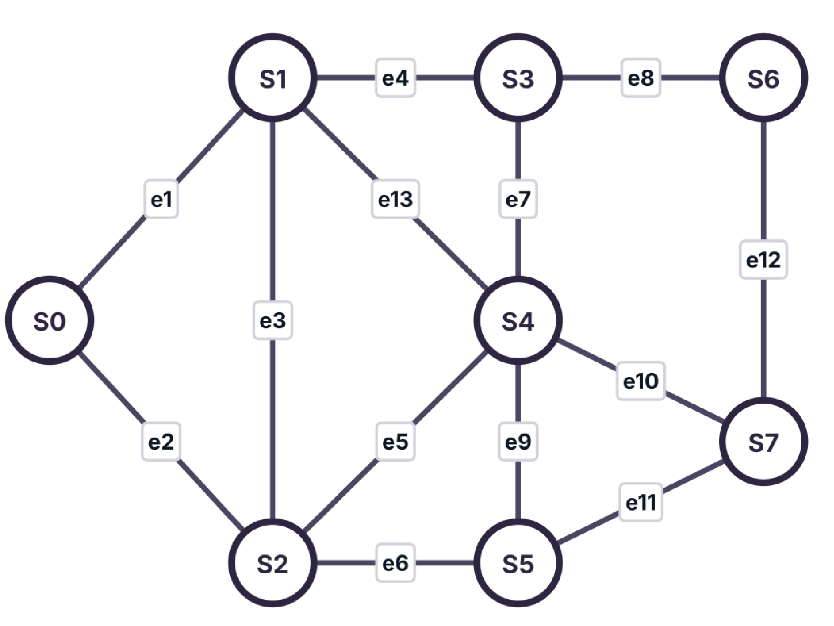
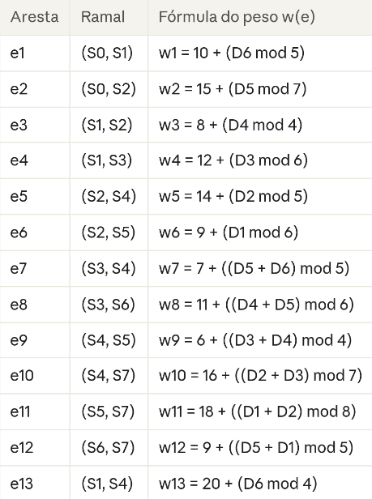
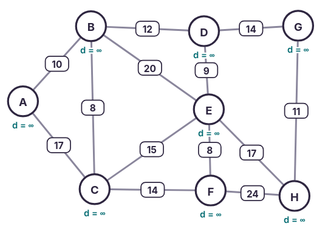
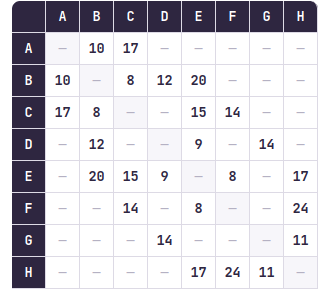
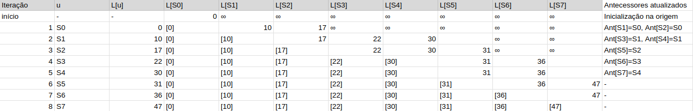
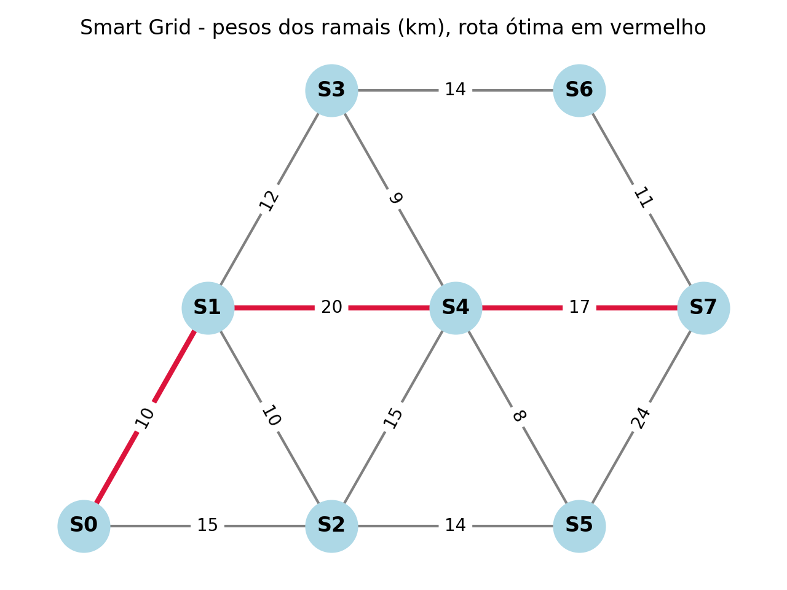

# Dev log

Para iniciar a atividade, o primeiro passo foi consultar os 6 úlitmos dígitos do meu RA individual: 510270, ou seja, D1=5, D2=1, D3=0, D4=2, D5=7, D6=0. Ele foi necessário para definir o destino e os pesos das arestas no grafo utilizado.

## Definição do destino

De acordo com o comando da atividade, o destino é dado por:

- D6 par = S7

- D6 ímpar = S6

Por isso, como meu D6=0, o destino do grafo é o vértice S7

## Criação do grafo

O grafo incial foi dado pela atividade:

 

Sendo o peso das arestas definidas pela seguinte regra:



Ao fazer os cálculos e substituir os pesos no grafo o resultado é o seguinte:



Essa imagem foi desenvolvida por meio do software disponibilizado pelo orientador. As distãncias que aparecem abaixo de cada vértice não representam a distância real, elas aparecem por padrão quando o algoritmo não é rodado.

Além disso, as letras representam os vértices em ordem alfabética, ou seja, S0=A, S1=B, S2=C, etc.

## ETAPA 1

### 1. Tabela e pesos do RA

- Os 6 dígitos do RA utilizado são 510270, portanto: D1=5, D2=1, D3=0, D4=2, D5=7, D6=0;

- O destino calculado é S7, de acordo com a regra descrita anteriormente;

- A matriz de pesos 8x8 com os valores obetidos foi desenvolvida no software desenvolvido pelo orientador:



## ETAPA 2

Para fazer o teste de mesa, foi utilizado o mesmo software dos outros itens e os resultados foram registrados em uma planilha:



O registro dele foi bem simples, o principal ponto observado nessa etapa foi que, uma vez que um caminho era achado, ele se mantinha até o fim. Isso é uma particularidade desse grafo e não representa uma regra geral, porém, é interessante de ser observado.

## ETAPA 3

Para essa etapa, foi criado o arquivo `main.py` utilizando a biblioteca NetworkX. O grafo foi montado com as 8 subestações e os 13 ramais, usando os pesos calculados para o meu RA. Também foi utilizado o Matplotlib para gerar o desenho do grafo, com a rota encontrada destacada em vermelho.



Depois de rodar o código, a saída do terminal foi a seguinte:

```text
RA: 510270 | destino: S7
Pesos e1–e13: [10, 15, 10, 12, 15, 14, 9, 14, 8, 17, 24, 11, 20]

Matriz de adjacência (None = -):
        S0   S1   S2   S3   S4   S5   S6   S7
S0       -   10   15    -    -    -    -    -
S1      10    -   10   12   20    -    -    -
S2      15   10    -    -   15   14    -    -
S3       -   12    -    -    9    -   14    -
S4       -   20   15    9    -    8    -   17
S5       -    -   14    -    8    -    -   24
S6       -    -    -   14    -    -    -   11
S7       -    -    -    -   17   24   11    -

Rota ótima: S0 -> S1 -> S4 -> S7
Custo mínimo: 47 km
Ordem de fechamento: S0 -> S1 -> S2 -> S3 -> S5 -> S4 -> S6 -> S7
Antecessores: {'S0': [], 'S1': ['S0'], 'S2': ['S0'], 'S3': ['S1'], 'S5': ['S2'], 'S4': ['S1', 'S2'], 'S6': ['S3'], 'S7': ['S4', 'S6']}
Custo no Prim: 74
```

Ao comparar o resultado com o teste de mesa, percebi uma diferença nos pesos e na ordem de fechamento. Pela fórmula do RA 510270, os pesos de e2 e e3 são 15 e 10. Na matriz e na tabela feitas manualmente, eles aparecem como 17 e 8. Por causa disso, no código S5 fecha antes de S4, mas o custo da rota até S7 continua 47 km e a rota continua sendo S0 → S1 → S4 → S7.

Também observei que o NetworkX mostra mais de um antecessor quando existem caminhos de mesmo custo. Por exemplo, ele mostra S1 e S2 como antecessores possíveis de S4. Na tabela manual foi registrado apenas S1, porque o caminho de mesmo custo não substitui o primeiro antecessor. A rota escolhida pelo código continua igual à da tabela.

Embora entenda que os valores dos pesos e2 e e3 estabelecidos manualmente estejam incorretos, optei por não elterar por conta do tempo, realizando o commit do jeito que está.

Usei IA para gerar os prints no terminal e o plot do gráfico.

